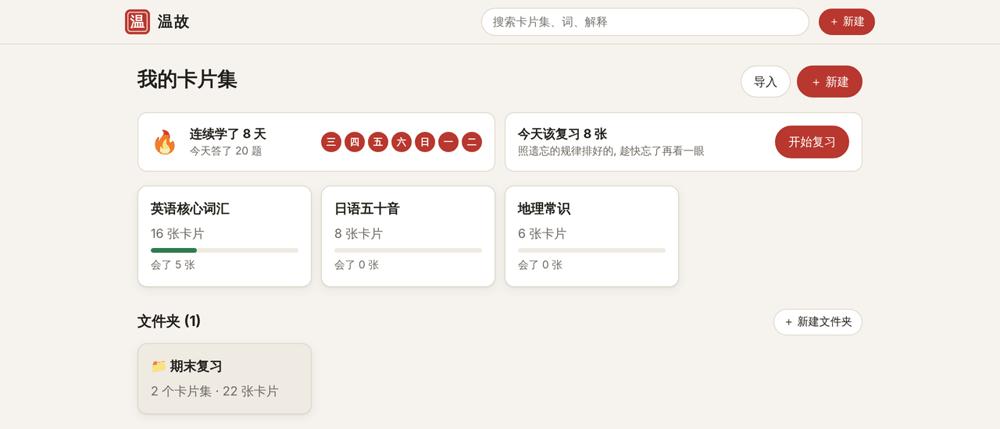
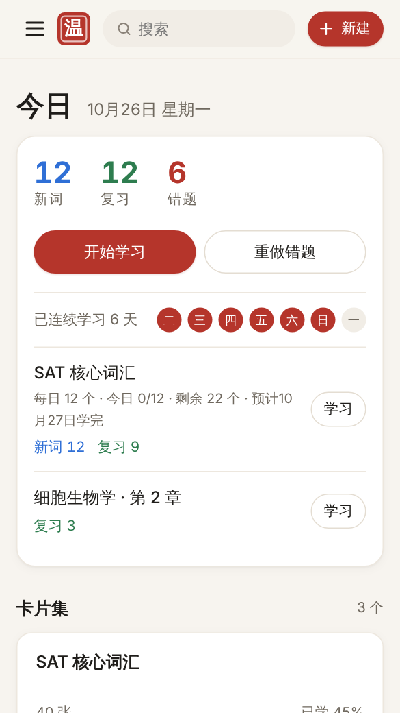
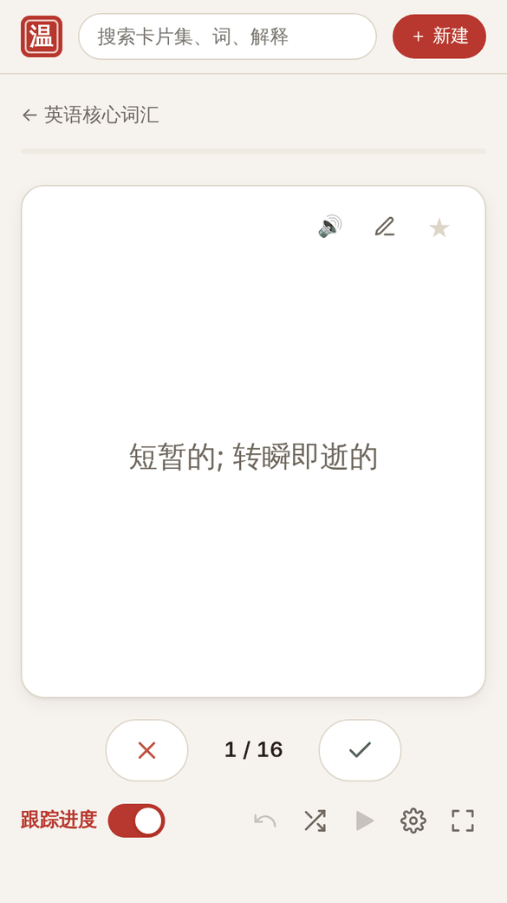
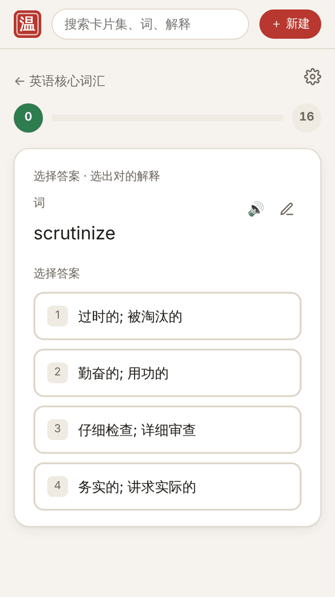
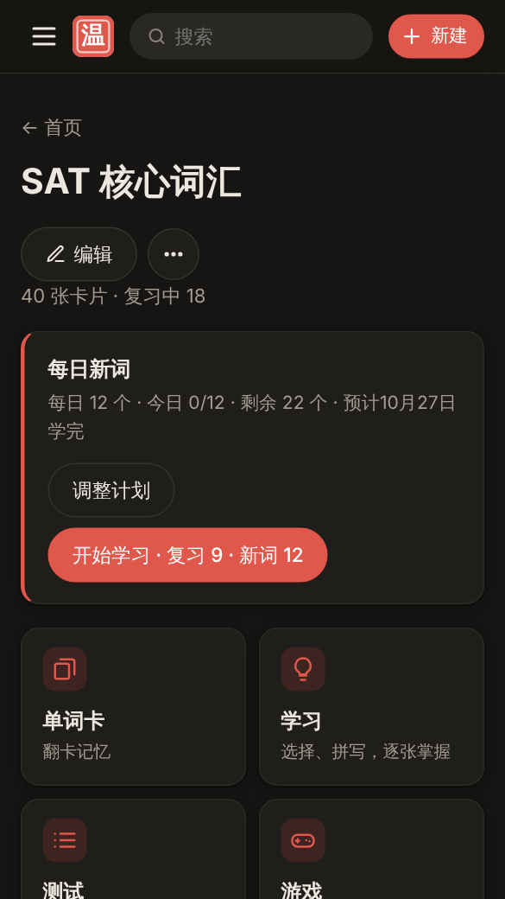

# 温故

个人学习工具：卡片记忆与间隔复习、题目集（错题、练习题）、测验与学习游戏。网页版和 iPhone / iPad App 都能用，多台设备自动同步。免费，无需注册。名称取自「温故而知新」。

**在线使用：<https://aizhang453-hash.github.io/wengu/>**

支持电脑与手机，手机上可「添加到主屏幕」。打开过一次后可离线使用。

<p align="center">
  
</p>

<p align="center">
  
  
  
  
</p>
<p align="center"><sub>手机首页 · 单词卡 · 学习 · 深色模式</sub></p>

## 功能

| | |
|---|---|
| **今日** | 汇总当日新词、到期复习与待重做错题，一键开始；显示连续学习天数 |
| **卡片集** | 单词卡、学习（选择、判断、拼写、听写）、测试、学习游戏、标注图；支持格式、图片、录音与在线词典 |
| **间隔复习** | FSRS-6 算法；设置了每日计划的卡片集参与每日复习，其他卡片集可随时学习；每日新词（可按考试日期计算）、每日复习上限、目标记忆率、按个人记录优化参数；难记卡片与暂停 |
| **题目集** | 题目按「题目集」存放（像卡片集，如「AP微积分」「SAT 阅读」）；记录错题与练习题：材料、题目、选项、答案与解析；拍照后由 AI 识别并批量录入；题型统计与专项练习；批量删除、移到其他题目集；连续答对 3 次即为掌握 |
| **书斋** | 古诗文原文免费读（以前叫「阅读」），书架分四层：诗词（唐诗三百首、宋词三百首、千家诗）、经典与古文（论语、古文观止）、启蒙读物（三字经、百家姓、千字文、弟子规、声律启蒙、增广贤文、朱子家训、幼学琼林）、古典小说（西游记，一回一回读）；每日一首、搜索、收藏、目录里的「接着读」、简体 / 繁体、朗读；《古文观止》里 33 篇名篇有注释、译文、出自这篇的成语和名句；搜索也能搜成语；一键做成「接下句」「字词」「成语」卡片集来背 |
| **导入与导出** | Quizlet（粘贴或书签）、Excel、CSV、Anki 卡组（含复习进度）、拍照生成卡片；导出 Excel、CSV、Anki，打印，分享链接 |
| **统计** | 复习预测、学习记录、记忆率、卡片状态、学习时段分析 |
| **同步与备份** | 通过个人 GitHub 私有仓库在多设备间同步；备份文件导出与恢复 |
| **更多** | 文件夹、搜索、考前清单、深色模式；学习游戏、游戏厅（3D 弹珠台、文字人生模拟「人生草稿」）、学习陪伴「温温」 |

## 使用说明

### 导航

- 左上角 ☰：今日、题目集、书斋、统计；「更多」中为学习游戏、游戏厅、温温；底部为设置。
- 右上角「新建」：新建卡片集、导入卡片、新建题目集、记录错题、拍照录入错题、新建文件夹。

### 卡片集

- 卡片集页提供单词卡、学习、测试、游戏（配对、打陨石、方块、宝石、Wordle），以及设置了标注图时的识图练习。
- 统计、加入文件夹、分享、复制为文本、导出、打印、重置进度、删除位于标题旁的「更多」中。
- 编辑页支持加粗、斜体、下划线、高亮，以及图片和录音；学习过程中也可随时编辑卡片。

### 复习

- 设置了每日计划的卡片集（或所在文件夹设置了计划）出现在「今日」中：每天安排新词，自评「会 / 不会」的卡片按 FSRS 安排复习。
- 未设置计划的卡片集（如课堂笔记）可随时学习，不安排每日复习；全部学过的卡片集可在卡片集页「加入每日复习」。
- 每日新词计划：固定数量，或按考试日期与剩余数量自动计算；考前若干天仅复习。
- 每日复习上限、目标记忆率与复习参数优化在「设置 › 复习」中调整。
- 自定义学习：加学新词、提前复习、重练今日遗忘、练习难记或星标卡片。

### 题目集（错题、练习题）

- 题目集：题按题目集存放，像卡片集一样，如「AP微积分」「SAT 阅读」「Il Postino 电影题」。左上角 ☰ 的「题目集」页列出所有题目集（也显示在「今日」下方，点右边的「全部」进去），点开后是其中的题目、题型分布、今日待重做与专项练习；题目集可在标题旁的「更多」中重命名或删除（连同其中的题目）。
- 手动记录：选择题目集，填写材料、题目、图片、选项（或填空答案）、我的答案、解析、题型。SAT 题型可自动识别。
- 拍照录入：复制提示词，连同题目照片发给 Claude、ChatGPT 等 AI，再将回复粘贴回来；做错的题和未作答的练习题均可录入。信息不完整的题目会逐题打开以便补充。
- 重做按 FSRS 安排：做错的题次日开始，未作答的练习题当日即可练习；连续答对 3 次即为掌握；可按题型专项练习。
- 批量操作：点击「选择」后勾选题目，或先按题型筛选、搜索，再「全选」，可删除或移到其他题目集。
- v1.49 以前记录的题目会自动分组：题型写成「AP微积分·乘法法则」的归入「AP微积分」（题目集中只显示「乘法法则」），SAT 题型归入「SAT 阅读写作」「SAT 数学」，其余以题型为名；没有题型的归入「未分类」。v1.42 以前的旧题目集也会恢复为同名的题目集。

### 书斋（书库）

- 书架：十四本书分四层——诗词、经典与古文、启蒙读物、古典小说，书竖着立在书架上，点书看简介和目录。原文来自开源项目 chinese-poetry，繁体的自动转成简体显示（宋词原本是简体，繁体是转回去的）；读一篇时可以切换，个别字可能转换有出入。整理时核对过资料：宋词丢掉的生僻字照《全宋词》补回，《千家诗》的错字照《唐诗三百首》改正（原来的写法记在注里），写错的作者对照维基文库改正，《宫词》两首被资料合成一篇的拆开了，版本注释放在正文下面。
- 古典小说：现在有《西游记》一百回，原文来自维基文库，对照古登堡计划（Project Gutenberg）的本子核对过（两份是同一个来源，一百回里连续四个字以上不一样的只有 10 处，都是维基文库对）。用的是清代流传的本子：第九回「陈光蕊赴任逢灾」讲唐僧的身世，是清代加进去的（现在常见的人民文学出版社版以明代世德堂本为底本，把这一回放在附录），书里写明了。小说很大，一回一个文件，读到哪回才下载哪回（离线时读过的回还能看）；App 里全部装好。小说先只放原文，不做卡片，搜索只搜回目。由 `tools/novel.mjs` 生成。
- 读：点书进目录，「接着读」回到上次读到的地方；按 ← → 换篇；可以调字号、朗读。
- 每日一首：每天从《千家诗》里选一首，显示在「今日」和书架上，每台设备上是同一首；节日那天换成节日的诗。
- 节日的诗：春节、元宵节、清明节、端午节、七夕、中秋节、重阳节、冬至、除夕当天，「每日一首」换成这个节日的诗（如中秋是苏轼《水调歌头·明月几时有》）。清单在 `js/library/festivals.js`，手写的；每年哪天照香港天文台的「公历与农历日期对照表」（2000–2100 年，`tools/festival-days.mjs` 生成 `js/library/festival-days.js`），不用浏览器自带的农历（有几年差一天，如 2027 年春节）。
- 搜索：在书架上按题目、作者、句子或成语找。
- 收藏：读一篇时点「收藏」，在书架下方找到。收藏和读到哪会跟着多设备同步、备份。
- 读音：通假字、古文多音字、姓的特别读音在字上方标拼音（照现在的语文课本），朗读也按这个念；清单在 `js/library/readings.js`，手写的。
- 注释和译文：《古文观止》里 33 篇名篇（语文课本里的《出师表》《桃花源记》《岳阳楼记》《师说》《赤壁赋》《过秦论》等，和成语多的《进学解》《冯谖客孟尝君》等），要注释的词下面画虚线、标号，点一下在页面底下看解释，正文下面列出全部注释；「译文」打开后每段下面跟着白话译文。注释照课本的讲法，有两种讲法的写「一说」；注释和译文都是温故自己写的，不抄别人的，对照维基文库、古诗文网核对过。在 `js/library/yizhu/guwen.js`，手写的。「注释」「译文」开关记在这台设备上。
- 唐诗宋词的注释和译文：《唐诗三百首》《宋词三百首》《千家诗》里语文课本要背的诗（照教育部课程标准的「古诗文背诵推荐篇目」，书库有的小学、初中、高中一共 66 首，如《静夜思》《登鹳雀楼》《春望》《水调歌头·明月几时有》《琵琶行》《蜀道难》《声声慢》），跟《古文观止》一样有注释和一行对一行的译文。两本书都收的（《静夜思》《枫桥夜泊》等）注释共用。《千家诗》220 首全部做完了（v1.61）。有的诗还有「创作背景」：什么时候、为什么写的，没有可靠说法的不写。在 `js/library/yizhu/tangshi.js`、`songci.js`、`qianjiashi.js`，手写的。
- 成语和名句：这 20 篇正文下面列出出自这篇的成语、名句和词语（只收出自这篇的，化用别的书的写明「语本……」），点「看原文」跳到那一段并标出那几个字；还有「知道吗」，写相关的常识，有的能点过去读书库里相关的那篇。在书架上也能搜成语，找到出处。
- 做成卡片背：「接下句」是正面一句、背面下一句（诗的第一张是「题目第一句」），「整首 / 整段」是正面题目、背面全文，有注释的篇还能做「字词」（正面是注释的词和它在的那一小句，背面是解释）和「成语」（正面成语，背面意思和出处原句）；可以只做这一篇，也可以整本做成一个卡片集。

### 导入

- 粘贴 Quizlet 导出的文本，或使用 Quizlet 一键导入书签（设置 › 其他）。
- 选择 Excel、CSV、Anki 卡组（.apkg / .colpkg）文件；Anki 卡组可保留复习进度，含进度的卡组自动开启每日计划。
- 拍照生成：复制提示词，连同单词表或笔记的照片发给 AI，再将回复粘贴到「导入」中。也支持 AI 返回的表格。

### 同步与备份

- 多设备同步：在「设置 › 同步与备份」中按步骤连接个人 GitHub 私有仓库；其他设备可扫码接入。修改会自动合并，不会互相覆盖。
- 备份：导出包含图片与录音的备份文件；恢复时与现有数据合并。

## iPhone / iPad App

温故也可以装成 iPhone / iPad 上的 App（`ios/` 文件夹；同一个 App 支持 iPhone 和 iPad）。目前没有上架 App Store，需要用 Mac 上的 Xcode 装到自己的设备上：

1. 在 Mac 上打开 `ios/Wengu.xcodeproj`。
2. Xcode 菜单 › Settings › Accounts 中登录自己的 Apple ID。
3. 左侧选中项目 Wengu › Signing & Capabilities，Team 选择自己的账号（Personal Team）。如提示 Bundle Identifier 不可用，在末尾加几个字母即可。
4. 用数据线连接 iPhone / iPad，在设备的「设置 › 隐私与安全性 › 开发者模式」中打开并重启。
5. Xcode 顶部选择自己的设备，点击 ▶ 运行。首次运行需在设备的「设置 › 通用 › VPN 与设备管理」中信任该开发者。

注意：

- **App 与浏览器中的卡片分开保存。** 要在 App 中使用已有卡片，请在电脑的「设置 › 同步与备份」中显示二维码，用 iPhone / iPad 的相机扫描，在打开的网页中点击「在 App 中连接」；也可以用备份文件恢复。
- 删除 App 会同时删除 App 中的卡片，请开启多设备同步或定期备份。
- 使用免费 Apple ID 安装的 App 7 天后无法打开，用 Xcode 重新运行一次即可（卡片不会丢失）。加入付费的 Apple 开发者计划后为一年。
- 网站更新后，App 需要用 Xcode 重新运行一次才会更新。
- 别人发来的分享链接会在浏览器中打开，点击「在 App 中导入」即可导入到 App。

## 常见问题

**数据保存在哪里？**
保存在当前设备的浏览器中，不会上传。更换设备或清除浏览器数据前，请导出备份或开启多设备同步。

**iPhone 上朗读没有声音？**
请关闭手机侧边的静音开关；如仍无声，可在「设置 › 辅助功能 › 朗读内容 › 声音」中下载语音。自行录制的音频不受影响。

**如何更新到新版本？**
联网时打开即为最新版本。已添加到主屏幕的，完全关闭后重新打开即可。

## 更新记录

当前版本 **v1.72.4**，详见 [CHANGELOG.md](CHANGELOG.md)。

## 开发

需要 [Node.js](https://nodejs.org/)：

```sh
npm start        # 本地运行：http://localhost:8000
npm test         # 运行测试
npm run sw       # 新增 js 文件后，更新离线缓存清单
node tools/library.mjs <原文文件夹> <opencc-js 的 full.js>   # 重新生成书库（一般不用；要先下载 chinese-poetry 和 opencc-js，放哪些文件见脚本开头）
```

直接打开 `index.html` 无法运行（浏览器不允许从本地文件加载 JavaScript 模块），请使用上述本地服务器。

<details>
<summary><b>代码结构</b></summary>

- `index.html`、`css/style.css`：页面与样式（颜色等定义为变量，深色模式另有一套）
- `js/app.js`：入口与路由；`js/dom.js`：元素、提示、对话框、菜单等基础组件
- `js/views/`：各页面
  - `home.js` 今日、`set.js` 卡片集、`folder.js` 文件夹、`settings.js` 设置、`menu.js` 菜单与新建菜单、`search.js` 搜索
  - `edit.js` 编辑卡片集、`fileimport.js` 文件导入、`export.js` 导出、`cardedit.js` 卡片快速编辑、`aiprompt.js` 提示词按钮
  - `cards.js` 单词卡、`learn.js` 学习、`exam.js` 测试、`review.js` 今日复习、`plan.js` 计划与复习设置对话框、`optimize.js` 参数优化、`stats.js` 统计、`diagram.js` 标注图
  - `mistakes.js` 题目集（v1.63 以前叫错题集；所有题目集、一个题目集）、`mistakeedit.js` 记录与编辑、`mistakereview.js` 重做、`mistakeimport.js` 拍照录入
  - `gamehub.js`、`gameshell.js`、`match.js`、`blast.js`、`blocks.js`、`gems.js`、`wordle.js`、`gamequiz.js`：学习游戏；`arcade.js`、`pinball.js`、`draft.js`：游戏厅
  - `share.js` 分享、`quizlet.js` Quizlet 书签、`sync.js` 同步设置、`pet.js` 温温、`examlist.js` 考前清单、`read.js` 阅读（书架、目录、读一篇、每日一首）
- 数据与逻辑
  - `js/store.js` 存储；`js/merge.js` 合并；`js/sync.js` GitHub 同步；`js/backup.js` 备份；`js/media.js` 图片与录音（IndexedDB）
  - `js/srs.js` 间隔复习（`js/vendor/fsrs.js`：ts-fsrs，MIT）；`js/plan.js` 每日计划；`js/revlog.js` 复习记录；`js/optimize.js`、`js/optimize-worker.js` 参数优化（改写自 fsrs-rs，BSD-3-Clause）
  - `js/questions.js` 出题；`js/learn.js` 学习模式；`js/exam.js` 测试；`js/grade.js` 判分；`js/scope.js` 学习范围；`js/custom.js` 自定义学习；`js/stats.js` 统计
  - `js/reading.js` 阅读：拿书、搜索、做卡片、每日一首、收藏和读到哪；`js/library/` 书的原文（`books.js` 书目，简体在 `js/library/`、繁体在 `js/library/hant/`，由 `tools/library.mjs` 从 chinese-poetry 生成，宋词的缺字照《全宋词》补；`readings.js` 读音、`yizhu/` 注释和译文是手写的）
  - `js/mistakes.js` 错题与题目集（含旧题目的自动分组）；`js/mistakeimport.js` 错题的 AI 识别；`js/cardimport.js` 卡片的 AI 识别；`js/aitext.js` 从 AI 回复中提取 JSON、转换 LaTeX；`js/quiz.js` 旧题目集转换
  - `js/parse.js` 粘贴文本；`js/cardfile.js` 文件导入导出（`js/xlsx.js`、`js/csv.js`、`js/anki.js`、`js/zip.js`、`js/sqlite.js`、`js/vendor/fzstd.js`：MIT）
  - `js/games.js`、`js/blocks.js`、`js/gems.js`、`js/wordle.js` 游戏规则；`js/pinball.js`、`js/pinball3d.js`（`js/vendor/three.js`：MIT）、`js/pinart.js`、`js/pindmd.js`、`js/pinsound.js` 弹珠台；`js/draft.js`（规则）、`js/draftdata.js`（出身、事件、路口、结局）人生草稿；`js/arcade.js` 游戏厅的成绩与进度
  - `js/speech.js` 朗读；`js/recorder.js` 录音；`js/sound.js`、`js/unlock.js` 音效；`js/dict.js` 词典；`js/rich.js` 文字格式；`js/cardview.js` 卡片显示；`js/diagram.js` 标注图；`js/search.js` 搜索；`js/print.js` 打印；`js/share.js` 分享链接；`js/quizlet.js` 书签；`js/qr.js`（`js/vendor/qrcode.js`：MIT）二维码；`js/pet.js` 温温；`js/examlist.js` 考前清单
- `sw.js`、`manifest.webmanifest`：离线使用与添加到主屏幕
- `ios/`：iPhone / iPad App。App 本身只是一个网页框（`WebViewController.swift`），编译时 `copy-web.sh` 按 `sw.js` 的清单把网页文件复制进 App；网页通过 `js/platform.js` 判断是否在 App 中。`make-icon.swift` 生成 App 图标
- `tests/`：测试；`docs/screenshots/`：说明中的截图

</details>

## 许可证

[PolyForm Strict 1.0.0](LICENSE)：可查看代码、个人使用，不可修改后再发布或商用。
书库原文（`js/library/`）来自 [chinese-poetry](https://github.com/chinese-poetry/chinese-poetry)（MIT，许可原文见 `js/library/LICENSE-chinese-poetry.txt`），简体由 OpenCC 转换。
第三方代码按其各自许可：`js/vendor/` 中的 ts-fsrs、fzstd、qrcode-generator、three.js（均为 MIT）；`js/optimize.js` 改写自 fsrs-rs（BSD-3-Clause，许可原文见文件末尾）。
