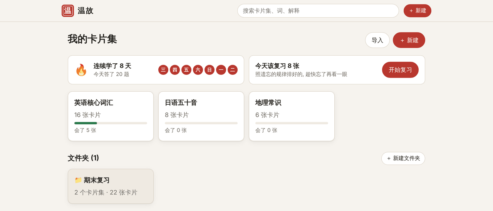
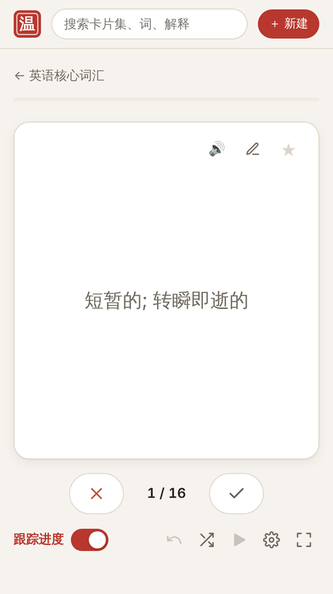
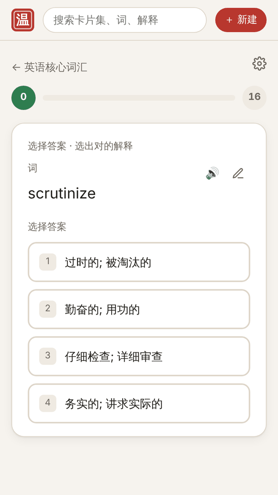
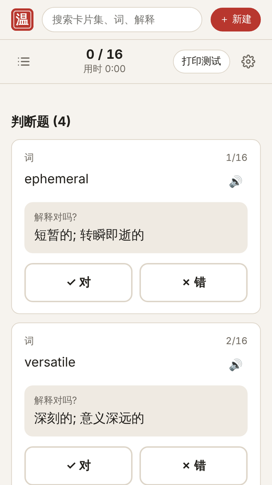
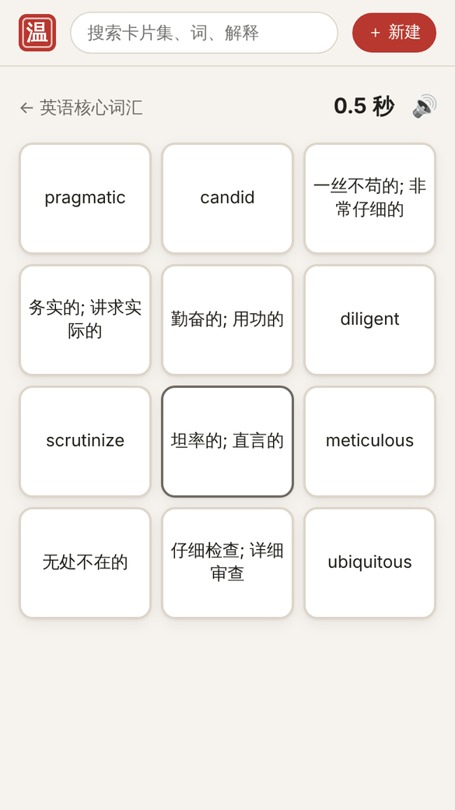
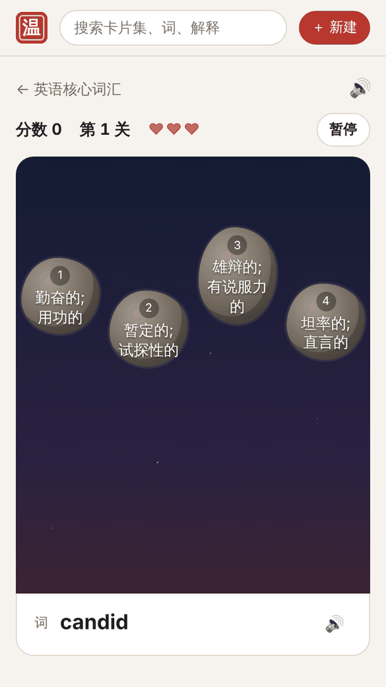
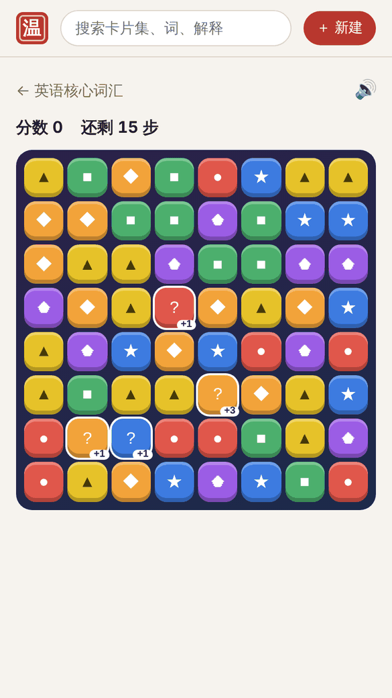
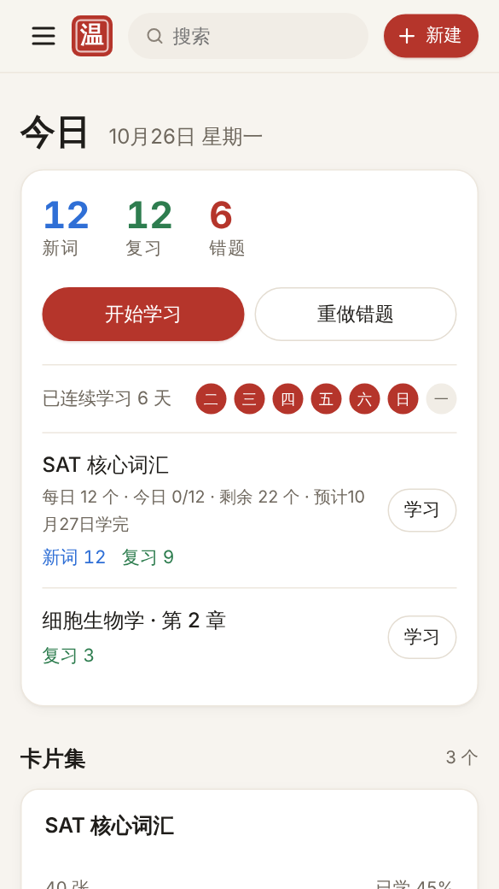
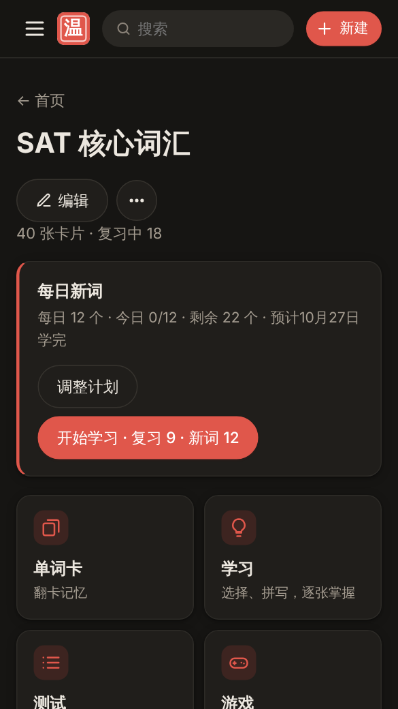

# 温故

自己的学习中心: 背卡片、按遗忘的规律排复习、学习和测试、题目集、错题集、学习游戏、统计都在一起。**全部免费、不限次数、不用注册**。名字出自「温故而知新」。

**打开就能用: <https://aizhang453-hash.github.io/wengu/>**

电脑、手机都行; 手机上可以「添加到主屏幕」, 像 App 一样。打开过一次以后, 没网也能背。

<p align="center">
  
</p>

<p align="center">
  
  
  
  
</p>
<p align="center">
  
  
  
  
</p>
<p align="center"><sub>单词卡 · 学习 · 测试 · 配对 · 打陨石 · 宝石 · 手机首页 · 夜间模式</sub></p>

## 能做什么

| 类别 | 温故里有 |
|---|---|
| **背** | 单词卡、学习模式 (答对为止)、测试 (出卷子打分)、听写、每天的复习 (用开源的 FSRS 算法排)、每天背几个新词 (也能按考试日期算, 考试前一天有考前清单)、难记卡、暂停、自定义学习、统计 (连一天里什么时候记得最牢)、连续打卡 |
| **玩** | 「学习游戏」(挑游戏、挑卡片集): 配对、打陨石、方块、宝石、Wordle; 「游戏厅」学累了玩的正经游戏: 弹珠台 (3D 视角、真的物理) |
| **题目集** | 每道题自己写选项 (单选、多选、判断), 限时答, 答得快分高、连对加分, 记成绩排行 |
| **错题集** | 做错的题 (比如 SAT) 记下来: 文章、题目、图片 (截图、函数图像)、选项、对的、当时选的、为什么错; 按题型分 (SAT 的题型自动认), 看哪类错得最多、单练一类; 用 FSRS 排重做, 连对 3 次算掌握 |
| **做卡片** | 写词和解释、加粗斜体高亮、放图片、自己录音、标注图 (地图、人体图上标点)、学着学着随手改 |
| **搬进来** | 从 Quizlet 复制粘贴、一键搬 (书签小工具)、Excel、CSV、Anki 卡组 |
| **拿出去** | 导出 Excel / CSV / Anki、复制成文字、打印 (表格或者折叠卡片)、分享链接和二维码 |
| **整理** | 左上角 ☰ 菜单 (主页、今天的复习、统计、错题集、游戏、新建、导入、文件夹、同步都在里面)、文件夹 (几个卡片集合起来学)、星标、搜索 |
| **陪你学** | 右下角的小乌龟「温温」: 学一题喂它一口, 跟着你长大 (蛋 → 宝宝 → 小乌龟 → 大乌龟 → 学霸龟); 看你的数据说今天该做什么 (计划跟不上了、哪张卡片老是忘、记住率低了……), 每星期说说学得怎么样; 100 句《论语》、30 个学习小窍门; 连续打卡放烟花、解锁装扮 |
| **存** | 卡片存在你自己的浏览器里, 不上传; 可以同步到你自己的 GitHub 私有仓库 (电脑、手机都用), 也可以导出备份文件 |

没有广告。

## 详细说明

点开看每个功能怎么用。

<details>
<summary><b>建卡片集</b></summary>

- 一面写词, 一面写解释; 在最后一张的解释里按 Tab 自动加一张新的; 一键把所有卡片的词和解释对调
- **文字格式**: 加粗、斜体、下划线、高亮 (点按钮, 或者 Ctrl+B / I / U、Ctrl+Shift+H)
- **图片**: 解释那面可以放一张图片 (点「图片」选, 或者直接粘贴、拖进来), 太大的会自动缩小
- **自己录音**: 词和解释都能用麦克风录自己的发音, 朗读时放你的录音
- **学着学着改卡片**: 单词卡、学习、测试的对答案、每天复习、卡片集页上都有 ✏️, 发现写错了点一下就改, 不用退出去;
  改完马上换成新的字 (学习模式里正在做的题、选项也跟着换), 进度不丢
- **星标**: 难记的加星标, 单词卡、学习、测试里可以只学这些
</details>

<details>
<summary><b>单词卡</b></summary>

- 点一下 (或按空格) 翻面; 卡片左上角「显示提示」(每个词露第一个字)
- 开着「跟踪进度」: 每张标「还不会 / 会了」(手机上左右滑, 电脑上按 ← →), 按钮上显示这一轮各几张, 能撤销;
  一轮完了可以接着只背还不会的, 一直背到全会
- 关着: 左右翻着看, 能自动播放
- 打乱顺序、全屏; 设置里: 只学星标、正面显示词还是解释、自动朗读、快捷键、重新开始单词卡模式
- 背到一半关掉, 下次打开接着背
</details>

<details>
<summary><b>学习模式</b></summary>

先选目标:
- **备考**: 时间紧, 先把整套过一遍, 每张答对一次就算过, 题型混着出
- **全部记住**: 每张先认出来 (选择 / 判断), 再写出来 (打字 / 听写 / 单词卡), 都答对才算掌握

每轮 7 张, 答错的这一轮后面再问一次, 一轮完了看看掌握了几张, 一直学到全部掌握。进度存着, 下次接着学。

**学哪些** (上面的「学: …」): 卡片多的 (比如从 Anki 搬来的上千个词) 不用一下全学 ——
**接着学 N 个** (照卡片集里的顺序, 还没背过、还没掌握的往下, 默认 20 个; 学完了「接着学下 20 个」)、
**今天的新词** (今天复习里要出的新词, 先用选择题、打字学一遍)、**星标的**、**全部**。超过 50 张的卡片集默认「接着学 20 个」。

- **智能判分**: 大小写、标点不算错; 括号里的可以不写; 有几个意思的写出一个就行; 打错一两个字母、少了重音符号也算对 (提醒你一下)。
  判错了可以点「我答对了」
- **听写**: 念出词 (卡片有录音就放录音), 听着把词打出来; 可以再听一遍、慢一点听;
  听不出来可以看解释当提示; 打对了顺便告诉你意思。在选项的「问题类型」里打开
- 选项: 随机、音效; 问题类型 (多项选择、判断、打字、听写、单词卡); 回答 (词、解释, 可以都开);
  更正选项 (智能判分、答错了把正确答案打一遍); 自动朗读; 重新开始学习模式
</details>

<details>
<summary><b>测试模式</b></summary>

- 打开先按上次的设置出一套卷子, 「设置你的测试」窗口盖在上面:
  从哪些出题 (背过的 / 今天背的 / 星标的 / 全部, 卡片多的默认「背过的」)、问题数、回答 (词 / 解释 / 两者都有)、
  判断对错、多项选择、配对、书面问题 (打字)、智能判分
- 上面显示答了几题、用时, 右边「打印测试」(可以附上答案) 和 ⚙ 重新设置; 左边题目列表, 点一下跳过去
- 每题标第几题、给的是词还是解释; 选了答案自动跳到下一题, 打字题按回车跳下一题
- 交卷后打分、看用时, 每题标出对错和正确答案; 判错了能点「我答对了」; 可以「只考错的」或者换一套题再考
</details>

<details>
<summary><b>学习游戏</b></summary>

- **学习游戏**: 左上角 ☰ 菜单里的「学习游戏」, 先挑玩哪个游戏, 再挑拿哪个卡片集 (文件夹也行) 玩; 记得上次玩的
- 游戏都是整页深色, 顶上一条 —— 左边换游戏、中间换卡片集、右边音效 / 设置 / 不玩了。
  字多的解释会自己缩小字号, 放得下为止, 英文单词不从中间断开
- **配对**: 12 张牌, 把词和解释配起来, 配对了就消失; 计时, 点错一次加 1 秒, 记最好成绩
- **打陨石**: 上面一大条出解释, 写着词的陨石往下掉, 点对的那块, 下面的飞船打碎它
  (设置里可以反过来: 出词, 打解释); 打错或者让对的那块掉到飞船那儿少一条命, 答对 5 题升一关、越掉越快;
  手机上陨石两块一排、摆两排, 每块大一点; 显示连对几题; 记最高分, 最后列出没打中的
- **方块**: 题目摆在棋盘左边 (手机上从下面升上来), 答对一题拿三块积木, 拖到 8×8 的棋盘上,
  填满一行或一列就消掉; 不会就点「不知道」看答案; 放不下了结束
- **宝石**: 交换相邻的宝石, 三颗以上同色连一线就消掉; 连四颗出炸弹; 消掉问题宝石出一道题 (跟方块一样摆在旁边), 答对加步数; 步数用完结束
- **Wordle**: 卡片集里的单词 6 次猜出来 (绿: 字母和位置都对, 黄: 有这个字母位置不对); 解释当提示, 可以藏起来; 记连胜
</details>

<details>
<summary><b>游戏厅: 弹珠台</b></summary>

- 左上角 ☰ 菜单「休息一下」里的「游戏厅」: 学累了玩一会儿的正经游戏 (不用卡片集)。现在有弹珠台, 以后再加
- **弹珠台**: 自己设计的台面 (星空、印章、「温故而知新」), 台面往后倒着放, 像真的弹珠机 (暂停里能换成平的)。
  竖着的手机上, 台面上面有一块顶箱, 亮着打亮了的字和奖励倍数
- 真的物理: 重力、弹簧发射 (拉得越久打得越远)、两块挡板 (能托住球)、三个蘑菇头 (100)、两个弹弓 (50)、
  回旋道 (沿顶上的圆弧绕一圈 1000)、单向门、出局道和回球道
- 规则: 三个球。顶上三条通道都亮 → 奖励倍数 +1 (最多 ×5, 按挡板能挪亮着的灯); 左边三个掉落靶都打下 → 3000, 左下的救命弹亮
  (球掉进左边出局道弹回去一次); 中间「温故而知新」五个字都打亮 → 10000 × 倍数 (一局第一次再奖励一个球);
  黑洞 1500 (吸住一会儿再吐出来); 每个球开始 8 秒内掉了救回来一次; 球掉了加奖励分 × 倍数; 球卡住了自动推一下
- 操作: 键盘 ← 或 Z 左挡板、→ 或 / 右挡板、按住空格拉弹簧松开发射、P 暂停; 手机、平板点屏幕左半边 / 右半边 (两边能一起按),
  按住右下角「发射」。切到别的应用自动暂停。音效自己合成 (右上角能关)
- 成绩: 记最高的 5 次, 跟着多设备同步、备份
</details>

<details>
<summary><b>题目集</b></summary>

- 左上角 ☰ 菜单里的「新建题目集」。跟卡片集不一样, 每道题自己写题目和选项:
  - **选择题**: 2–6 个选项, 点 ✓ 标出对的; 标两个以上就是**多选题** (全选对才算对)
  - **判断题**: 点「对」还是「错」
  - 每题可以放一张图片 (点「加图片」或者直接粘贴), 自己定限时 (5 秒到 2 分钟); 题目可以上下挪、复制、删掉
  - 没写完的题保存时会标出来 (少选项、没标对的)
- **答题**: 先只看题目一会儿, 然后出彩色的选项 (红 ▲、蓝 ◆、黄 ●、绿 ■……), 开始倒计时;
  答对最多 1000 分, 越快越多 (时间用完那一刻还有 500), 连对每题多 100 (最多多 500); 键盘按 1–6 选, 回车下一题
- 每题答完马上看对错、得了几分、对的答案; 最后看总分、正确率、答错的题; 可以「只练答错的」
- 可以不限时练习 (只看对几题)、打乱题目顺序、打乱选项顺序
- 题目集页有「我的成绩」排行榜 (限时答的, 留最近 20 次); 成绩跟着多设备同步, 两台设备答的都在
- 可以用分享链接发给别人 (选项、对错都带着); 一个人自己答, 不能大家用手机进房间一起比 (那要服务器)
</details>

<details>
<summary><b>错题集</b> (复习 SAT 这种考试用)</summary>

- 左上角 ☰ 菜单里的「错题集」(首页也有今天该重做几道)。点「＋ 记一道错题」:
  - **文章 / 材料** (可以不写): SAT 阅读写作题的那段文字、数学题给的条件
  - **题目**
  - **图片** (可以不放, 一道最多 6 张): 题目截图、函数图像、几何图; 点「加图片」, 或者直接粘贴 (Ctrl+V)、拖进来。
    整道题截了图的, 题目可以不打字。重做时点图片放大看
  - **选择题**: 写选项 (A、B、C、D, 可以加到 F), 点「✓ 对」标出对的, 点「✕ 我选的」标出当时选错的那个
  - **填空题** (像 SAT 数学的填空): 写对的答案和当时写的; 数字按数字比, 3/4、0.75、.75 都算对, 四舍五入的也算; 几个都对的用逗号隔开
  - **为什么错 / 解析**: 自己的笔记
  - **题型** (可以不写): 自己写, 或者从列表里挑; 不写的按题目猜 —— SAT 阅读写作每类题的问法是固定的, 都认得出来
    (词汇题、目的和结构、双篇对比、主旨细节、文本证据、图表证据、推理题、语法·标点、语法·词形、过渡词、笔记整合;
    语法题看选项: 只差标点的是「语法·标点」), 数学按关键词分 (代数、高级数学、数据分析、几何三角), 认不出来的算「其他」。
    写题目的时候下面就写着猜的是什么
  - 「保存, 再记一道」: 一套题做完一口气记好几道
- **重做**: 刚记的明天开始排进复习; 重做时先不给答案, 做完看对的答案、上次选错的、为什么错。
  用 FSRS 排 (见下面「每天的复习」): 做对了隔得越来越久再出, 又错了 10 分钟后再来; **连对 3 次算掌握**, 不再排进复习 (以后又错了会重新排回来)。
  有文章的题, 电脑上左边文章、右边题目 (跟 SAT 考试的界面一样); 键盘按 A–D 或 1–4 选, 回车下一题
- **按题型** (错题集页上面): 每类几道、还有几道没掌握、重做时对了几成, 错得最多的写在最上面; 「练这类」只做这类还没掌握的。
  每道错题上写着题型 (虚线框的是猜的, 在「改」里可以换), 下面可以只看一类
- 首页「今天该重做几道」; 错题集页可以「还没掌握的全做一遍」、只做某一道, 按「该重做 / 还在练 / 已掌握」筛, 在文章、题目、选项、笔记、题型里搜
- 错题 (连图片) 跟着多设备同步 (一道一道合, 手机上记的、电脑上记的都在)、备份
</details>

<details>
<summary><b>每天的复习、连续打卡</b></summary>

- **今天的复习** (间隔重复): 「翻卡自评」过的卡片 —— 单词卡里 (开着跟踪进度) 标了会了 / 还不会的、
  学习里的单词卡题、今天的复习里点了记得 / 不记得的 —— 会排到以后某一天再出来。
  首页「今天要背的」是一张表: 每个卡片集 (文件夹下面列着里面的) 今天几个新词、几张复习、几张积压 (超过每天上限往后排的),
  每行「背」只背那一个, 「全部开始」全背; 张数在首页、卡片集页、文件夹页、复习页都一样。
  背的时候点「不会 / 忘了」的隔几张再出来, 一直到点「会 / 记得」; 点错了能「↶ 撤销」(或按 Z)。
  按钮上写着点了以后多久再来 (「✗ 忘了 · 10 分钟后」「✓ 记得 · 20 天后」)。
- **难记卡、暂停**: 背过以后又忘了的次数记着, 忘了 8 次算**难记卡**, 复习时提醒一下 (12 次、16 次……再提醒):
  光多背几遍不一定管用, 换个记法 (加例句、图片、拆词根、编谐音), 能直接改卡片。复习时能点「**明天再背这张**」(今天先不背) 或「**暂停这张**」;
  暂停了不排复习、不当新词出, 记录都留着, 在卡片集页 (卡片右边的 ⏸、「暂停的」) 或统计页恢复。Anki 里暂停了的卡片, 导入以后也暂停
- **自定义学习** (「今天的复习」页下面, 做完了也有): 再学几个新词、接着复习超过上限的、**提前复习** (还没到日子、最可能忘的先来,
  照常排下次, 考前巩固用)、今天忘了的再过一遍、难记卡练一下、星标的练一下 (后三种是练习: 只算答对答错, 不动复习的日子)
- **每天背新词** (卡片集页上的「📅 每天背多少?」): 卡片集太大不可能一下背完, 定个计划, 每天给你几个新词 (还没背过的卡片),
  跟到日子的复习一起出 (均匀插在中间, 带「新词」两个字, 按 会 / 不会)。两种定法:
  - **每天固定几个** (默认 20 个), 会告诉你照这样哪天学完
  - **按考试日期算**: 填考试那天和「考前几天只复习」(默认 3 天), 按还剩几个、离考试几天自动算每天几个 (每天重算); 考前那几天不给新词
  - **考前清单**: 考试前一天, 首页上面一条「明天考试 · 考前清单」(温温也会提醒): 今天要过一遍的 (按自己的数据:
    今天的复习还有几张、还没掌握的错题几道、哪类错得最多先做、难记卡、星标的, 点「去做」直接去)、要带的东西
    (准考证和证件、考试用的电脑 / 平板充满电、计算器、铅笔、水和零食、路线和闹钟)、今晚别熬夜早点睡; 一样一样打勾 (存在这台设备上)。
    考试那天早上换成「出门前」和「考的时候」
  - 新词默认按卡片集里的顺序 (导入的就是文件里的顺序); 导入时可以勾「新词打乱顺序背」, 以后在编辑页或计划里也能改成随机、重新打乱。
    在单词卡里翻过、说了会不会的也算学过 (算进今天学的)。今天的做完了还想学, 可以「再学 10 个新词」
- **每天最多复习几张** (默认 200, 「今天的复习」页下面能改, 所有卡片集一起算): 到日子的太多时 (很久没背了、刚导入 Anki 的卡组),
  先来最可能忘的, 剩下的明天再来; 今天看过、忘了又到时候的不算; 想今天全做完也可以点「接着复习剩下的」。
  选择题、判断题、打字、测试、游戏、Wordle、标注图只算答对答错几次和打卡, **不动复习的日子**:
  选择题能蒙、能靠选项认出来, 游戏也不是真的自己想起来的, 拿来排复习不准
- **怎么排**: 用开源的 [FSRS](https://github.com/open-spaced-repetition/ts-fsrs) 算法 (FSRS-6)。
  艾宾浩斯遗忘曲线说的是「记住的东西会随时间忘掉, 复习一次忘得慢一点」; FSRS 照这个道理, 给每张卡片 (每道错题) 记两个数:
  **稳定性** (过多少天还有 90% 的把握记得) 和 **难度** (老答错的难、涨得慢), 算出「隔几天复习, 到时候还有 90% 记得」。
  比固定的「1 天、3 天、一周」准: 简单的很快就隔一个多月, 老错的多来几次。
  答对了: 第一次隔 2 天, 之后十来天、一个多月……; 答错了: 10 分钟后再来, 今天再答对的话明天再看。
  以前 (v1.15 以前) 的复习记录会换算过来接着排, 不用从头来。
  **到期日子错开**: 同一天背的一批卡片, 隔 3 天以上的在前后几天里挑一天, 要复习的少的那天更容易挑中,
  不会全挤在同一天
- **想记住的把握** (「今天的复习」页下面的「🎯 想记住 90%」): 上面的 90% 能调 (70%–97%)。
  调高复习得勤、记得牢 (考前用); 调低每天背得少, 但忘得多; 窗口里写着间隔会变成几倍。已经排好的日子不动, 下次复习起按新的排
- **复习记录**: 每一次翻卡自评都记下来什么时候、记没记得 (只记这一种; 从 Anki 搬来的复习记录也算), 跟着同步、备份。
  错题集的重做有自己的排法 (也用 FSRS 的默认参数), 不算进这个记录
- **按我的记录优化复习排法** (「今天的复习」页下面的「📈 复习排法」): FSRS 有 21 个参数 (隔多久再复习、多快会忘),
  默认的是很多人的平均; 点「开始优化」, 拿你自己的翻卡自评记录 (连从 Anki 搬来的) 算一套更合你的
  (照开源的 fsrs-rs 写的: 去掉怪的记录、先估第一次以后能记几天、再梯度下降), 在你的浏览器里算, 几万次复习一两秒。
  - 会拿你的记录比一比: 默认参数和新算的, 哪个预测「这次还记不记得」更准 (预测误差、对数损失, 越小越准); 新的更准才让你换
  - 换了以后, 有完整记录的卡片按新参数重算记得多牢 (排好的复习日子不动, 下次复习起按新的排); 随时能换回默认参数
  - 只用从第一次背起都记着的卡片 (v1.17 以前就背过、只记了一部分的不算); 记录太少时只调「第一次以后能记几天」。
    攒到 1000 次左右最好, 以后多攒了可以再优化一次。参数跟着多设备同步
- **连续打卡**: 首页显示连续学了几天、最近 7 天哪天学过
- **统计** (☰ 菜单里的「统计」, 卡片集页、文件夹页也有「📊 统计」; 可以只看一个卡片集 / 文件夹):
  今天翻了几次、学了几个新词、忘了几次、大约用了多久; 以后一个月 / 三个月每天要复习几张 (柱状图);
  最近一年每天背了多少 (日历格子, 颜色越深背得越多); **记住率** (到日子复习时还记得的比例: 今天、7 天、30 天、一年);
  卡片背到哪了 (新词、学习中、还嫩、记牢了、暂停的) 和估计现在记得几张; 难记卡、暂停的列表 (能改、暂停、恢复);
  **一天里什么时候记得最牢**: 最近半年清早、上午、中午、下午、傍晚、晚上、深夜复习时各记住了几成。最好的时间段比你最常学的确实高
  (差 3 个百分点以上, 而且次数够多, 不是碰巧) 才建议换到那时候学; 差得不多就说差不多。记录不够 (一共不到 150 次) 先不说
</details>

<details>
<summary><b>小乌龟温温</b></summary>

- 住在首页、卡片集页、统计、错题集这些页的右下角; 背卡、测试、游戏、编辑、打字的时候不出来, 不挡按钮
- **喂它就是学习**: 答一题、重做一道错题、玩一局游戏都是喂一口 (以前学过的也算上)。吃够了会长大:
  蛋 (0) → 宝宝 (20) → 小乌龟 (300) → 大乌龟 (1500) → 学霸龟 (6000)。今天的复习背完它就吃饱了;
  几天不学会饿、会想你, 但不会生病、不会离开
- **心情**: 吃饱了开心、今天还没学饿了、还有好多没背着急 (举个牌子「还有 N 张」)、很晚了困了、好几天没来想你了
- **点它**: 说一句有用的, 带按钮直接去。都是看你自己的卡片、复习记录算出来的, 要紧的先说:
  - 今天还有几张、照你平时的速度大概几分钟 (去背); 错题集该重做几道 (去重做); 积压的
  - 按考试日期的计划跟不上了: 最近 7 天少学了好多新词, 每天要学的越来越多
  - 到了考前只复习的日子, 还有新词没学; 离考试一星期以内: 别学新的了, 多重做错题、早点睡
  - 最近 7 天复习时记住的比你定的低不少: 新词先少学一点
  - 点名最难记的那张 (「ubiquitous」已经忘了 9 次了), 「改这张」直接打开改卡片, 加个例句、图片
  - 很久没碰、还有好多新词、也没定计划的卡片集; 好几天没来、晚上了还没学 (连续打卡要断了)、很晚了叫你睡觉
  - 错题里哪类最多 (「练这类」); 一天里什么时候记得最牢 (比你平时学的时间确实好才说); 考试前一天、考试那天先说考前清单
- 说过的不重复说 (数变了才再说); 有用的话、《论语》、学习小窍门轮着来。说话下面一排:
  **还有呢** (下一句有用的)、**学得怎么样** (这 7 天学了几天、答了几题、跟上一个 7 天比、学了几个新词、记住了几成、记牢了几张、错题掌握了几道)、
  **论语**、**小窝**
- **《论语》100 句**: 讲学习、坚持、改错、思考的 (「学而时习之」「温故而知新」「知之为知之」「三人行必有我师」
  「不迁怒, 不贰过」「举一反三」……), 写着谁说的 (孔子、曾子、子夏……)、哪一篇, 带白话意思。100 句都念一遍才从头来;
  一半的时候挑合适现在的 (有错题要重做说改错的、好几天没来说坚持的、考试快到了说别急的)
- **学习小窍门 30 个**: 先想再翻面、每天一点比考前突击强、睡觉帮你记、配例句和图片、长得像的词放一起比……
- **自己说话**: 每天第一次见面打个招呼 (说今天最要紧的); 隔一个星期, 打招呼时说说这 7 天学得怎么样; 隔一阵念一句《论语》;
  长大了、解锁了装扮、今天的背完了、有新的难记卡的时候说一声; 连续打卡到 3、7、14、30、50、100…… 天放烟花
- **装扮**: 围巾 (连续打卡 3 天)、小红花 (一天的复习全背完)、毛线帽 (7 天)、眼镜 (一共学了 1000 次)、学士帽 (30 天)、皇冠 (10000 次);
  学到了就解锁, 不用买, 在「温温的小窝」里换
- **温温的小窝** (点它说话里的「小窝」, 或者 ☰ 菜单最下面): 长到哪了、还差几口长大、心情、这 7 天学得怎么样、装扮、改名字;
  这台设备上显示不显示、自己说不说话、缩成小圆点
- 长到哪了、解锁的装扮、名字跟着多设备同步和备份走; 显示不显示、说不说话每台设备自己定
- 自己画的, 白天、夜间模式都好看; 系统设了「减少动态效果」就不动
</details>

<details>
<summary><b>朗读</b></summary>

- 每张卡片都能念出来 (用浏览器自带的声音, 不用联网); 卡片上有自己的录音就放录音
- 词和解释的语言 (编辑页) 可以选 26 种: 英语 (美国 / 英国)、中文 (普通话 / 台湾)、粤语、日语、韩语、法语、德语、
  西班牙语 (西班牙 / 拉美)、意大利语、葡萄牙语 (巴西 / 葡萄牙)、俄语、阿拉伯语、荷兰语、波兰语、土耳其语、瑞典语、希腊语、
  希伯来语、印地语、泰语、越南语、印尼语
- 也可以「自动」: 看整个卡片集这一面大多是什么语言 —— 特别的字母 (ñ ¿ ¡ 西班牙语, ß ä ö ü 德语, œ ê ç 法语, ã õ 葡萄牙语,
  ì ò 意大利语, ą ł 波兰语, ğ ş 土耳其语……) 和常见的小词 (el、der、le、il……)。所以西班牙语卡片集里没有特别字母的 perro 也念西班牙语;
  英语卡片集里几个 café、naïve 还念英语, 只有特别明显的 (jalapeño) 按它自己的。中文、日语、韩语、俄语、阿拉伯语、希伯来语、泰语、希腊语、
  印地语一看文字就知道。编辑页「自动」后面写着现在猜的是什么 (比如「自动 (像是西班牙语)」), 猜错了就自己选
- 声音是设备自带的: 某种语言念不出来, 到设备的设置里下载那种语言的声音 (iPhone、iPad: 设置 → 辅助功能 → 朗读内容 → 声音)
- 念不出来的时候, 屏幕下面会说为什么 (比如这台设备没有这种语言的声音)
</details>

<details>
<summary><b>标注图</b></summary>

- 编辑页「标注图」里传一张图 (地图、人体、零件图……), 在图上点一下就加一个点, 图下面直接写它叫什么;
  点可以拖动, 已有的卡片也能「标到图上」
- 卡片集页显示带编号的图, 点数字看是什么
- 「标注图」练习: 「这是哪个?」(点亮一个点, 选名字) 和「找到它」(给名字, 在图上点出来), 答错的最后再来, 直到全对
- 单词卡的解释那面也会显示这个点在图上哪里; 图也跟着同步、备份
</details>

<details>
<summary><b>从 Quizlet、Excel、Anki 搬过来</b></summary>

- **复制粘贴**: 在 Quizlet 上打开卡片集, 点「…」→「导出」→「复制文字」, 粘贴进来就行。
  词和解释之间认 Tab / 逗号 / 自定义, 卡片之间认换行 / 分号 / 自定义 (跟 Quizlet 导出时的选项一样), 粘贴时自动猜, 下面先给你看认出来几张。
  Excel、Word 里一列词一列解释的表格复制过来也行
- **一键搬**: 装一个书签小工具 (首页「导入」里有链接, 或者打开 `#/quizlet`), 在 Quizlet 的卡片集页面上点一下,
  整个卡片集 (词、解释、朗读语言、网上的图片) 就打开在温故里, 点「导入」就是自己的了。别人做的卡片集也行, 不用开会员。
  电脑上把按钮拖到书签栏; 手机上复制代码自己建一个书签
- **导入文件**: 编辑页的「导入」里点「选文件」(或者直接把文件拖进来):
  - **Excel** (.xlsx, WPS、Numbers、Google 表格导出的也行) 和 **CSV**: 自动认出第一行是不是标题、哪一列是词、哪一列是解释, 不对可以自己选;
    中文版 Excel 存的 CSV (GBK 编码) 也认; 有几个工作表的, 可以挑一个、合在一起, 或者每个工作表建一个卡片集
  - **Anki 卡组** (.apkg 或整个收藏 .colpkg, 新版老版 Anki 导出的都行, 几百 MB 的也行): 连图片和声音 (词的、解释的) 一起搬过来; 加粗、斜体、换行保留; 完形填空 (Cloze) 变成「挖空的句子 → 答案」;
    **带学习进度**: Anki 里导出时勾上「包含学习进度」, 每张卡片在 Anki 里的复习记录 (重来、困难、良好、简单四个键) 也搬过来,
    用 FSRS 从头算一遍, 接着 Anki 的进度排复习 (很久没背的会排进今天的复习, 每天最多复习 200 张, 能改), 记录也放进复习记录里以后优化参数用。
    一个笔记有正反两张卡片的, 用复习得多的那张的记录; Anki 里手动改的日期、重置以前的记录不算;
    按字段名猜哪个是词、哪个是解释 (Word / Meaning 这种), 单独的图片字段、发音字段也带上;
    字段多的 (比如 单词 / 意思 / 例句) 可以在「解释后面再接上」选例句, 接在解释下面;
    一个卡组里有好几个牌组的, 可以每个牌组建一个卡片集: 大牌组 (比如 4000 Essential English Words) 变成文件夹, 下面的小牌组 (1.Book、2.Book……) 变成里面的卡片集
  - Anki 导出的文字 (.txt), 普通的 .txt (比如 Quizlet 导出的文字) 放进粘贴框照常拆
  - 卡片很多 (两千张以上) 时可以「直接建成卡片集」, 不经过编辑页
</details>

<details>
<summary><b>导出、打印、分享</b></summary>

- **导出文件**: 卡片集页「导出文件」, 存成 Excel、CSV, 或者 Anki 能导入的 .txt (加粗、斜体、换行都保留)
- **复制成文字**: 卡片集变回 Tab 和换行隔开的文字, 能直接粘回 Quizlet
- **打印卡片集**: 打成表格 (左边词、右边解释), 或者打成折叠卡片 (剪下来沿虚线对折, 做成纸质单词卡)
- **分享链接**: 卡片集页点「分享」, 整个卡片集压成一条链接 (短的还有二维码, 手机上能直接调系统的分享菜单)。
  别人点开先看看有什么, 点「导入」就变成他自己的卡片集。不用注册、不经过服务器; 只带文字, 自己加的图片和录音太大带不了
</details>

<details>
<summary><b>文件夹、搜索</b></summary>

- **文件夹**: 把几个卡片集放进一个文件夹 (一个卡片集可以放进好几个文件夹), **合起来一起学**:
  单词卡、学习、测试都能用 (游戏板块里也能挑文件夹来玩), 学到的进度记回每张卡片原来的卡片集。
  文件夹也能定「每天背新词」的计划: 新词照文件夹里卡片集的顺序, 一个背完再下一个 (顺序能用 ↑ ↓ 挪)。
  首页上文件夹排前面, 里面的卡片集列在文件夹下面
- **搜索**: 顶上的搜索框, 在所有卡片集的名字、词、解释里找, 边打边出结果
</details>

<details>
<summary><b>多设备同步、备份</b></summary>

- **多设备同步**: 存到你自己的 GitHub 私有仓库 (首页最下面「设置多设备同步」, 照着三步做, 大概三分钟)。
  之后打开、改动、回到页面时自动同步, 图片录音、学习进度、复习日子都同步; 手机扫电脑上的二维码就能连上。
  卡片先同步, 图片录音随后几 MB 一包传 (Anki 卡组上万个也行), 同步页上写着传到哪了。
  删掉的卡片集、卡片用过的图片录音: 过一个星期从仓库删掉 (万一别的设备还要), 每台设备上的也会清掉, 不会越存越多。
  **清理仓库的旧历史** (同步页最下面): GitHub 每同步一次存一个版本, 旧版本 (连删掉的图片录音) 都留着, 只占 GitHub 那边的地方;
  点一下只留现在这一个版本 (先同步一次; 现在的卡片、进度、图片录音都不动, 别的设备照常同步)。清了就退不回旧版本, 不清也没关系 (1 GB 以内都没事)
  两台设备都改过的会合并, 不会互相盖掉 (同一个卡片集两边各加了卡片, 都留下); 一台删了另一台也删。
  连接时填上密钥哪天过期 (网页自己读不到这个日期), 还剩两周时首页和顶上会提醒, 同步页「换密钥」一步步教你建新的, 卡片不会丢
- **备份**: 卡片 (连图片、录音) 都存在你的浏览器里, 不上传。换电脑、换浏览器或者清浏览器数据之前, 在首页点「导出备份」存一个文件, 到那边再「导入备份」。
  导入备份: 这里没有的 (包括删掉了的) 加回来; 这里还有的跟备份合在一起, 这里后来改的、背的不会退回去
- **断网也能用**: 打开过一次以后, 没网也能打开、照常背; 有网的时候打开就是最新版本
- 夜间模式跟着系统走
</details>

## 常见问题

**卡片存在哪? 会不会丢?**
存在你这台设备的浏览器里, 不会上传到别的地方。清浏览器数据、换设备之前, 先「导出备份」, 或者设置多设备同步。

**iPhone 上点 🔊 没声音?**
看看手机侧边的静音开关: 开着静音时, iPhone 会把网页朗读也静音 (Safari、Chrome 都一样), 关掉静音就有声了。
还是没声音的话, 看看音量, 再到「设置 → 辅助功能 → 朗读内容 → 声音」里下载一个声音。自己录的音不受影响。

**怎么用上新版本?**
有网的时候打开就是最新的。加到了主屏幕的, 把它完全关掉再打开。

**有什么做不了?**
搜全网别人公开的卡片集 (可以用分享链接互相发)、大家用各自手机一起实时比赛 (题目集只能一个人答)、教科书答案。
这些要一台一直开着的服务器, 或者是别人的内容, 不是自己一个网页能做的。

## 更新记录

现在是 **v1.33**。每一版改了什么见 [CHANGELOG.md](CHANGELOG.md)。

## 自己在电脑上跑

不用装别的东西, 有 [Node.js](https://nodejs.org/) 就行:

```sh
npm start        # 打开 http://localhost:8000
npm test         # 跑测试
npm run sw       # 新加了 js 文件以后, 更新「断网要存的文件」名单
```

(直接双击 `index.html` 打不开, 浏览器不让网页从文件夹里读 JavaScript 模块, 要像上面这样开一个小服务器。)

<details>
<summary><b>代码文件都是干什么的</b></summary>

- `index.html`、`css/style.css`: 网页和样子
- `js/app.js`: 入口, 按网址决定显示哪一页
- `js/dom.js`: 造网页元素、弹提示、开窗口的小工具
- `js/views/`: 每一页
  - `home.js` 首页、`set.js` 卡片集页、`folder.js` 文件夹、`search.js` 搜索、`gamehub.js` 游戏板块
  - `edit.js` 新建 / 编辑卡片集、`fileimport.js` 选文件导入、`export.js` 导出文件、`cardedit.js` 学着学着改卡片的小窗口
  - `cards.js` 单词卡、`learn.js` 学习、`exam.js` 测试、`review.js` 今天的复习、`plan.js` 每天背新词的计划、想记住的把握、`optimize.js` 优化复习排法的窗口、`stats.js` 统计、`diagram.js` 标注图
  - `gameshell.js` 游戏页顶上那一条和挑卡片集的列表、`match.js` 配对、`blast.js` 打陨石、`blocks.js` 方块、`gems.js` 宝石、`wordle.js` Wordle、`gamequiz.js` 游戏里出的题
  - `quizedit.js` 新建 / 编辑题目集、`quizset.js` 题目集页、`quizplay.js` 答题
  - `mistakes.js` 错题集、`mistakeedit.js` 记错题 / 改错题、`mistakereview.js` 重做错题
  - `share.js` 分享、`quizlet.js` 一键搬的说明页、`sync.js` 多设备同步的设置页
- `js/store.js`: 卡片集怎么存
- `js/parse.js`: 把粘贴的文字拆成卡片
- `js/grade.js`: 判打字的答案对不对 (智能判分)
- `js/questions.js`: 出题 (选择、判断、打字、配对)
- `js/learn.js`: 学习模式怎么排题
- `js/exam.js`: 测试模式怎么出卷子、打分
- `js/games.js`: 有哪几个游戏、哪个卡片集能玩; 配对的牌、打陨石的关卡
- `js/blocks.js`、`js/gems.js`、`js/wordle.js`: 方块、宝石、Wordle 的规则
- `js/quiz.js`: 题目集的题目怎么存、判对错、算分、记成绩
- `js/mistakes.js`: 错题怎么存、判对错 (填空题的数字)、排哪天重做、同步时怎么合
- `js/speech.js`: 朗读; `js/unlock.js`: 让 iPhone 上出得了声; `js/sound.js`: 音效
- `js/rich.js`: 文字格式 (加粗、斜体、下划线、高亮)
- `js/media.js`: 图片、录音存在哪 (浏览器的 IndexedDB)
- `js/recorder.js`: 录音
- `js/backup.js`: 备份文件 (连图片、录音)
- `js/cardview.js`: 各页面显示卡片内容用的小工具
- `js/diagram.js`: 标注图存什么、怎么出题
- `js/search.js`: 搜索
- `js/print.js`: 打印卡片集
- `js/srs.js`: 间隔重复 (哪天该复习、到期日子错开、想记住的把握、忘了几次, 用 `js/vendor/fsrs.js`: ts-fsrs, Open Spaced Repetition, MIT 许可)、连续打卡
- `js/revlog.js`: 每一次翻卡自评的记录 (按自己的记录优化 FSRS 参数用)
- `js/optimize.js`、`js/optimize-worker.js`: 按自己的记录优化 FSRS 参数 (照 [fsrs-rs](https://github.com/open-spaced-repetition/fsrs-rs) 改写, Open Spaced Repetition, BSD-3-Clause 许可), 在后台算
- `js/pinball.js`: 弹珠台的台面、物理、规则 (画面在 `js/views/pinball.js`); `js/arcade.js`: 游戏厅有哪些游戏、成绩
- `js/examlist.js`: 考前清单 (窗口和首页那一条在 `js/views/examlist.js`)
- `js/plan.js`: 每天的计划 (每天几个新词、按考试日期算、新词的顺序) 和今天要背的 (复习上限、最可能忘的先来)
- `js/pet.js`: 小乌龟温温长到哪了、心情、装扮、该说什么、《论语》; 画它、点它说话在 `js/views/pet.js`
- `js/scope.js`: 学习、测试用哪些卡片 (接着学 N 个、背过的……); `js/custom.js`: 自定义学习 (提前复习、难记卡……); `js/stats.js`: 统计
- `js/sync.js`、`js/merge.js`: 多设备同步 (GitHub)、两份数据怎么合并
- `js/share.js`: 分享链接 (卡片集压缩进网址)
- `js/quizlet.js`: 「从 Quizlet 一键搬」的书签小工具 (在 Quizlet 的页面上读卡片, 变成分享链接)
- `js/cardfile.js`: 从文件导入卡片、导出文件; 用到 `js/xlsx.js` (Excel)、`js/csv.js`、`js/anki.js` (Anki 卡组和文字)、
  `js/zip.js`、`js/sqlite.js` (只读的 SQLite, Anki 卡组里面是 SQLite 数据库)、`js/vendor/fzstd.js` (解压 zstd, Arjun Barrett, MIT 许可)
- `js/qr.js`、`js/vendor/qrcode.js`: 二维码 (qrcode-generator, Kazuhiko Arase, MIT 许可)
- `sw.js`、`manifest.webmanifest`: 断网也能用、添加到主屏幕
- `docs/screenshots/`: 这个说明里的截图
- `tests/`: 测试
</details>

## 许可证

[PolyForm Strict 1.0.0](LICENSE): 可以看代码、自己用, 不能拿去改了再发、不能商用。
别人写的部分按它们自己的许可: `js/vendor/` 里的 (ts-fsrs、fzstd、qrcode-generator, 都是 MIT), `js/optimize.js` (照 fsrs-rs 改写, BSD-3-Clause, 许可原文在文件最后)。
